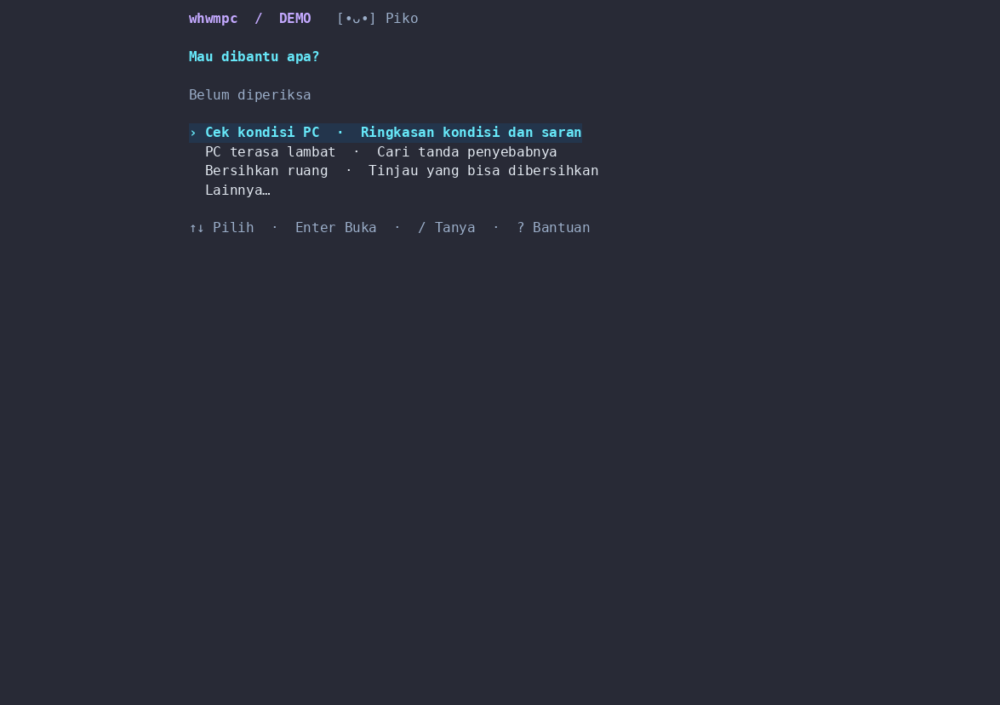

# What Happens With My PC

`whwmpc` membantu memahami kondisi PC, mencari tanda penyebab masalah, dan meninjau perawatan yang sesuai sebelum menerapkannya. Piko menemani pemeriksaan di terminal. Semua diagnosis inti berjalan offline.



[Sebelum](docs/assets/ux/before-80.png) · [Sesudah](docs/assets/ux/after-80.png) · [Demo Piko](docs/assets/piko-demo.gif) · [Alur dan rekaman PTY](docs/UX.md)

Ringkasan hasil menampilkan bar CPU, RAM, dan disk, suhu terbaca, serta status SSD, TRIM, dan profil daya. Gunakan Enter untuk melihat detail dan Esc untuk kembali. [Cek kondisi pada 80×24](docs/assets/ux/results/overview-80x24.after.png) · [Rekaman](docs/assets/ux/results/overview-80x24.cast) · [Perbandingan layar hasil](docs/UX.md#bukti-dari-pty)

## Mulai

### Linux

Pasang rilis standalone terbaru di Linux amd64 atau arm64 dengan `curl`, `awk`, `tar`, dan `sha256sum`. Installer memeriksa SHA-256 arsip dan memasang binari ke `~/.local/bin` tanpa sudo atau Go.

```sh
curl -fsSL https://raw.githubusercontent.com/christiandoxa/whwmpc/main/install.sh | sh
~/.local/bin/whwmpc --version
~/.local/bin/whwmpc
```

Gunakan `~/.local/bin/whwmpc --demo` untuk mencoba data simulasi. Jika `~/.local/bin` sudah ada di `PATH`, cukup ketik `whwmpc`. Jalankan ulang installer untuk memperbarui binari.

Untuk memasang versi tertentu, sertakan tag rilis.

```sh
curl -fsSL https://raw.githubusercontent.com/christiandoxa/whwmpc/main/install.sh | sh -s -- v0.5.0
```

Jika sudah punya checkout repo, jalankan `./install.sh` atau `./install.sh v0.5.0` dari direktori repo. [Skrip installer](install.sh)

### Windows

Pasang rilis standalone terbaru dengan Windows PowerShell 5.1 atau PowerShell 7 dan `curl.exe`. Installer memilih paket amd64 atau arm64, memeriksa SHA-256, dan memasang `whwmpc.exe` ke `%LOCALAPPDATA%\Programs\whwmpc` tanpa Administrator atau Go. Installer telah diuji pada Windows 11 dan Windows Server 2025.

```powershell
$installer = [scriptblock]::Create((Invoke-WebRequest -UseBasicParsing 'https://raw.githubusercontent.com/christiandoxa/whwmpc/main/install.ps1').Content)
& $installer
$exe = Join-Path $env:LOCALAPPDATA 'Programs\whwmpc\whwmpc.exe'
& $exe --version
& $exe
```

Gunakan `& $exe --demo` untuk mencoba data simulasi. Jalankan ulang `& $installer` untuk memperbarui binari.

Untuk memasang versi tertentu yang menyediakan arsip Windows, sertakan tag rilis.

```powershell
& $installer -Version v0.5.0
```

Jika sudah punya checkout repo, jalankan `.\install.ps1` atau `.\install.ps1 -Version v0.5.0` dari direktori repo. [Skrip PowerShell](install.ps1)

### Instalasi manual

Untuk instalasi dari arsip di Linux, macOS, atau Windows, pilih paket yang cocok dengan perangkat dan cocokkan checksum dari rilis yang sama. [Unduhan manual](https://github.com/christiandoxa/whwmpc/releases/latest) · [Cara memasang dari arsip](docs/RELEASE.md)

### Navigasi

Pilih tujuan lebih dulu. Layar akses muncul sebelum pemeriksaan pertama dengan **Mulai tanpa administrator** sebagai pilihan awal. Pilihan administrator memakai prompt sistem operasi dan melanjutkan tujuan yang sudah dipilih. Ganti tingkat akses dari Pengaturan. [Cakupan Linux, macOS, dan Windows](docs/PRIVILEGE.md)

Beranda menyediakan **Cek kondisi PC**, **Cari penyebab PC lambat**, dan **Bersihkan ruang**. Gunakan **Pemeriksaan lain** untuk SSD, TRIM, daya, riwayat, laporan, pengaturan, dan pertanyaan bebas. **Tugas lanjutan** membuka GPU, firmware, filesystem, benchmark, dan status observasi terjadwal.

| Tombol | Fungsi |
| --- | --- |
| ↑/↓ atau j/k | Pilih dari daftar atau gulir detail |
| Enter | Buka pilihan yang ditandai |
| Esc | Kembali atau minta penghentian |
| / atau ? | Buka pertanyaan bebas atau bantuan |

Demo memakai data fixture dan mengunci tindakan sistem. Di galeri, `m` memilih mode gerak dan `n` mencoba layout ringkas. Konfigurasi sesi tersedia lewat `--lang id|en`, `--theme dark|light|terminal`, `--ascii`, dan `--motion full|reduced|off`. `--no-animations` setara dengan off. Tema juga menghormati `NO_COLOR`. [Peta motion dan pose](docs/MOTION.md)

### Build dari sumber

Installer memakai rilis stabil terakhir. Untuk membangun revisi `main` dengan Go 1.27.4, jalankan perintah berikut dari checkout yang sudah diperbarui.

```sh
go build -o ./whwmpc ./cmd/whwmpc
./whwmpc --demo
```

## CLI

```sh
whwmpc check --json
whwmpc doctor
whwmpc trim
whwmpc power
whwmpc clean --dry-run
whwmpc report --format markdown --output pc.md
whwmpc history
```

Untuk membaca data tambahan dari CLI tanpa prompt, gunakan `whwmpc --privileged-read check --json` dengan otorisasi sistem yang sudah tersedia. [Cara kerja CLI mendalam](docs/PRIVILEGE.md#cli-tanpa-prompt)

`check --json` dan `report --format json` menghasilkan laporan berskema dengan sumber `live` atau `demo`. Laporan menyaring nama pengguna, hostname, serial, label perangkat, path pribadi, dan nama proses. Riwayat menyimpan ringkasan hingga 100 entri. Di detail, Enter membuka pilihan penyimpanan. **Simpan hasil ini** mengekspor data yang sudah terbuka. **Buat laporan lengkap** melakukan pemeriksaan tambahan. Pilih **Simpan ringkasan** atau gunakan `check --record` jika ingin menyimpan hasil scan. Hasil aksi yang diajukan dicatat otomatis. Laporan tanpa `--output` ditulis ke stdout.

Status pemeriksaan yang tidak lengkap muncul sebagai data. Exit code **0** berarti pemeriksaan atau perintah selesai, **1** berarti kegagalan atau aksi belum terverifikasi penuh, dan **2** berarti opsi salah. Non-TTY memakai keluaran plain atau JSON. Tampilan TUI memerlukan stdin dan stdout berupa terminal.

### Tindakan sistem

Jalankan aplikasi sebagai user biasa. Preview mencantumkan cakupan, operasi, risiko, privilege, dan expiry. Sesudah konfirmasi Piko menampilkan pemeriksaan ulang, tahap aksi, dan verifikasi. Rencana lama atau target yang berubah perlu ditinjau ulang.

```sh
whwmpc power --plan balanced --write-plan power-plan.json
whwmpc apply --file power-plan.json --confirm ID_DARI_PREVIEW
```

Gunakan `trim --mount /mountpoint`, `trim --enable-timer`, atau `clean --dry-run` dengan `--write-plan` untuk menghasilkan rencana CLI. Setelah operasi konfigurasi yang sah dan terverifikasi, `history` menampilkan ID untuk `restore --action ID --write-plan restore-plan.json`. Pastikan lokasi file yang dipilih privat jika rencana memuat path. [Model tindakan dan batas verifikasi](docs/ACTIONS.md)

### Tugas lanjutan

| Perintah | Fungsi |
| --- | --- |
| `whwmpc gpu` | Lihat GPU, sensor yang tersedia, dan parameter driver. [GPU dan tuning](docs/HARDWARE.md) |
| `whwmpc firmware` | Lihat inventaris firmware lokal. [Pembaruan dan verifikasi](docs/FIRMWARE.md) |
| `whwmpc filesystem` | Lihat volume yang bisa diperiksa. [Pemeriksaan dan perbaikan](docs/FILESYSTEM.md) |
| `whwmpc benchmark --help` | Pilih benchmark CPU, stress yang diawasi, atau pengujian file. [Metodologi](docs/BENCHMARK.md) |
| `whwmpc daemon --help` | Lihat lifecycle untuk observasi systemd user yang diaktifkan secara eksplisit. [Panduan daemon](docs/DAEMON.md) |

### Dukungan

| Platform | Cakupan | Bukti pengujian |
| --- | --- | --- |
| Linux amd64, baseline Ubuntu 24.04 LTS | `/proc` dan `/sys`, SMART, TRIM, CPUFreq, PPD, GPU yang didukung driver, fwupd, filesystem ext offline, cache APT | CI Ubuntu, PTY 80×24/120×36, probe/preview hardware baca-saja, dan tes perbaikan pada image ext2/3/4 sementara |
| Linux arm64 | Provider dan backend Linux yang sama, mengikuti capability host | Build lintas arsitektur. Workflow rilis melakukan smoke executable pada Linux arm64 |
| Debian, Fedora 44, Arch Linux, Arch Linux ARM aarch64 | APT serta versi DNF5 dan pacman yang tercantum di matriks | Fixture dan CI kontainer Fedora/Arch. [Cakupan cache paket](docs/PACKAGE-CACHE.md) |
| Container, VM, WSL, Linux tanpa systemd | Pemeriksaan menurut data yang diekspos. Operasi membutuhkan backend dan target yang terverifikasi | Deteksi fixture |
| macOS 14+ dan Windows 11/Server 2025, amd64/arm64 | CPU, memori, disk, proses, uptime, daya, status pengisian ketika tersedia, data storage, serta cek APFS/NTFS baca-saja | Lihat versi, arsitektur, dan cakupan perangkat yang diuji. [Matriks native](docs/NATIVE.md) |

Tool opsional di Linux mencakup `smartctl` (smartmontools), util-linux dan systemd/journal untuk audit TRIM, BusyBox dengan applet `fstrim` untuk aksi manual, serta `busctl` dan daemon profil daya. `doctor` menampilkan ketersediaan tool dan capability aktual. Pengujian mutasi memakai fixture, image sementara, atau kontainer. [Bukti dan batas pengujian per fitur](docs/BACKLOG.md)

Preferensi Linux mengikuti `XDG_CONFIG_HOME` (default `~/.config/whwmpc`), sedangkan state mengikuti `XDG_STATE_HOME` (default `~/.local/state/whwmpc`). macOS dan Windows memakai direktori konfigurasi pengguna dari OS. Aplikasi membuat file konfigurasi ketika preferensi disimpan.

[Arsitektur](docs/ARCHITECTURE.md) · [Aturan diagnosis](docs/DIAGNOSTICS.md) · [Pengembangan dan tes](docs/DEVELOPMENT.md) · [Progres](docs/PROGRESS.md) · [Changelog](CHANGELOG.md)

## Lisensi

whwmpc menggunakan Apache License 2.0. Hak cipta © 2026 Christian Doxa Hamasiah. [LICENSE](LICENSE) · [NOTICE](NOTICE)
