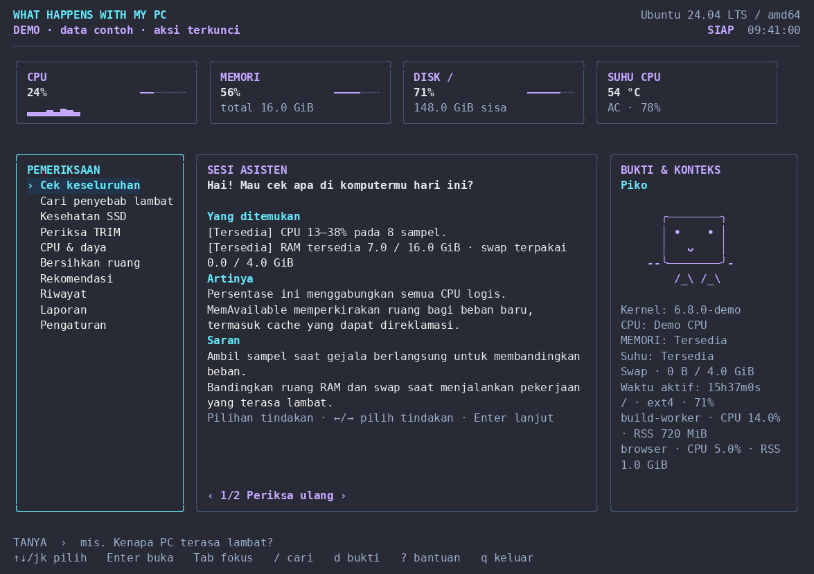

# What Happens With My PC

`whwmpc` adalah asisten terminal lokal untuk memahami kondisi PC. Tanyakan kenapa PC terasa lambat, audit SSD dan TRIM, lihat kebijakan CPU dan daya, atau tinjau pembersihan cache. Piko menemani pemeriksaan di terminal. Semua diagnosis inti berjalan offline.



[Rekaman galeri Piko dan alur konfirmasi demo](docs/assets/piko-demo.gif) · [Rekaman terminal asli](docs/assets/piko-demo.cast)

## Mulai

Pasang rilis standalone terbaru di Linux amd64 atau arm64. Installer memeriksa SHA-256 arsip dan memasang binari ke `~/.local/bin` tanpa sudo atau Go.

```sh
curl -fsSL https://raw.githubusercontent.com/christiandoxa/whwmpc/main/install.sh | sh
~/.local/bin/whwmpc
~/.local/bin/whwmpc --demo
```

Jika `~/.local/bin` sudah ada di `PATH`, gunakan `whwmpc` atau `whwmpc demo animations`. Jalankan ulang installer untuk memperbarui binari. Checksum diambil dari rilis GitHub yang sama. [Unduhan manual](https://github.com/christiandoxa/whwmpc/releases/latest) · [Build dari sumber](docs/RELEASE.md)

Coba **“Kenapa PC terasa lambat?”** untuk melihat bukti CPU, RAM, disk, proses, dan daya. **“SSD atau TRIM?”** meminta klarifikasi. **“Rekomendasi”** menanyakan konteks penggunaan dan mengingat pilihan yang kamu simpan.

| Tombol | Fungsi |
| --- | --- |
| ↑/↓ atau j/k | Pindah kategori atau gulir temuan |
| Tab / Shift+Tab | Pindah fokus antara menu, hasil, dan input |
| ←/→, Enter | Pilih tindakan di panel hasil dan buka pilihan |
| /, d, r | Cari atau bertanya, buka bukti, periksa ulang |
| e, m, ? | Ekspor laporan, ganti mode gerak, buka bantuan |
| Esc, q / Ctrl+C | Kembali atau minta penghentian, keluar |

Demo memakai data fixture dan mengunci tindakan sistem. Di galeri, `m` memilih mode gerak, `n` mencoba layout ringkas, dan Esc kembali ke daftar. Konfigurasi sesi tersedia lewat `--lang id|en`, `--theme dark|light|terminal`, `--ascii`, dan `--motion full|reduced|off`. `--no-animations` setara dengan off. Tema juga menghormati `NO_COLOR`. [Peta motion dan pose](docs/MOTION.md)

## CLI

```sh
whwmpc check --json
whwmpc doctor
whwmpc trim
whwmpc power
whwmpc clean --dry-run
whwmpc report --format markdown --output pc.md
whwmpc history
```

`check --json` dan `report --format json` menghasilkan laporan berskema dengan sumber `live` atau `demo`. Laporan menyaring nama pengguna, hostname, serial, label perangkat, path pribadi, dan nama proses. Riwayat menyimpan ringkasan hingga 100 entri. Pilih **Simpan ringkasan** atau gunakan `check --record` jika ingin menyimpan hasil scan. Hasil aksi yang diajukan dicatat otomatis. Laporan tanpa `--output` ditulis ke stdout.

Status pemeriksaan yang tidak lengkap muncul sebagai data. Exit code **0** berarti pemeriksaan atau perintah selesai, **1** berarti kegagalan atau aksi belum terverifikasi penuh, dan **2** berarti opsi salah. Non-TTY memakai keluaran plain atau JSON. Tampilan TUI memerlukan stdin dan stdout berupa terminal.

### Tindakan sistem

Jalankan aplikasi sebagai user biasa. Preview mencantumkan cakupan, operasi, risiko, privilege, dan expiry. Sesudah konfirmasi Piko menampilkan pemeriksaan ulang, tahap aksi, dan verifikasi. Rencana lama atau target yang berubah perlu ditinjau ulang.

```sh
whwmpc power --plan balanced --write-plan power-plan.json
whwmpc apply --file power-plan.json --confirm ID_DARI_PREVIEW
```

Gunakan `trim --mount /mountpoint`, `trim --enable-timer`, atau `clean --dry-run` dengan `--write-plan` untuk menghasilkan rencana CLI. Setelah operasi konfigurasi yang sah dan terverifikasi, `history` menampilkan ID untuk `restore --action ID --write-plan restore-plan.json`. Pastikan lokasi file yang dipilih privat jika rencana memuat path. [Model tindakan dan batas verifikasi](docs/ACTIONS.md)

### Dukungan

| Platform | Cakupan | Bukti pengujian |
| --- | --- | --- |
| Linux amd64, baseline Ubuntu 24.04 LTS | `/proc` dan `/sys`, SMART, TRIM, CPUFreq, PPD, cache APT | Fixture dan CI Ubuntu, PTY 80×24/120×36, probe dan preview baca-saja pada mesin Linux amd64 |
| Linux arm64 | Provider dan backend Linux yang sama, mengikuti capability host | Kompilasi dan build paket snapshot |
| Debian, Fedora, Arch | Audit Linux mengikuti kernel/tool host. Cleaner APT hanya untuk keluarga APT yang dideteksi | Fixture dan compile. Perangkat distro ini belum diuji |
| Container, VM, WSL, Linux tanpa systemd | Pemeriksaan menurut data yang diekspos. Operasi membutuhkan backend dan target yang terverifikasi | Deteksi fixture |
| macOS / Windows | Identitas runtime dan jumlah CPU logis. Metrik lain berstatus unsupported | Compile-only macOS arm64 dan Windows amd64 |

Tool opsional di Linux mencakup `smartctl` (smartmontools), util-linux dan systemd/journal untuk audit TRIM, BusyBox dengan applet `fstrim` untuk aksi manual, serta `busctl` dan daemon profil daya. Perubahan profil memakai API power-profiles-daemon. APT dan TRIM memerlukan izin sistem sesuai rencana. `doctor` menampilkan ketersediaan tool dan capability aktual. Uji perangkat nyata dalam pengembangan ini dibatasi pada pembacaan dan preview.

Preferensi Linux mengikuti `XDG_CONFIG_HOME` (default `~/.config/whwmpc`), sedangkan state mengikuti `XDG_STATE_HOME` (default `~/.local/state/whwmpc`). macOS dan Windows memakai direktori konfigurasi pengguna dari OS. Aplikasi membuat file konfigurasi ketika preferensi disimpan.

[Arsitektur](docs/ARCHITECTURE.md) · [Aturan diagnosis](docs/DIAGNOSTICS.md) · [Pengembangan dan tes](docs/DEVELOPMENT.md) · [Progres](docs/PROGRESS.md) · [Changelog](CHANGELOG.md)
